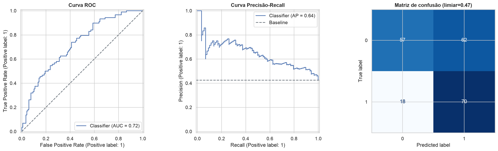
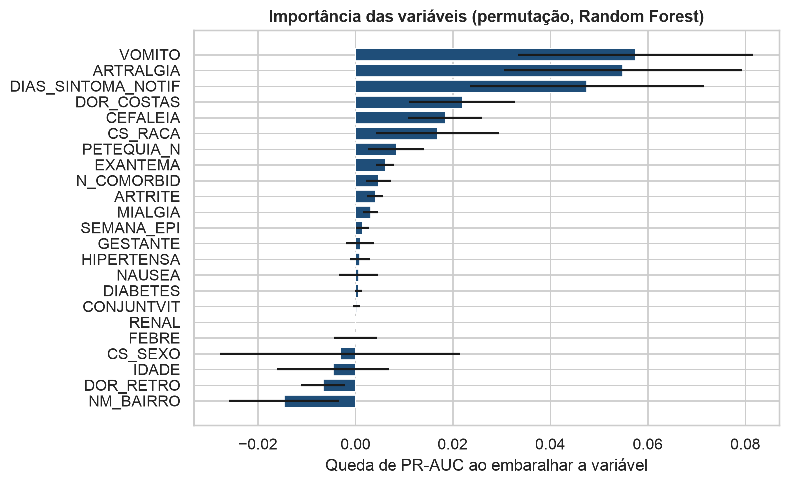
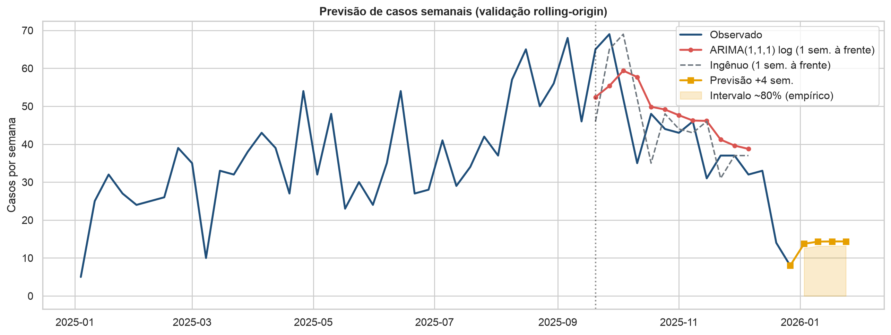

# Chikungunya em Recife (2025): análise epidemiológica, estatística e machine learning

Pipeline reprodutível em Python que analisa **1.942 casos confirmados** de chikungunya em Recife em 2025: limpeza e controle de qualidade, análise exploratória, testes de hipótese, modelagem preditiva de hospitalização, previsão de casos semanais e agrupamento de bairros por perfil epidemiológico.

Os dados são de notificação (SINAN), disponibilizados como dados abertos pela Prefeitura do Recife. A base bruta não está no repositório, e nenhuma informação individual é publicada.

> **Resumo dos achados:** Um terço dos casos concentra-se em apenas cinco bairros (liderados por Cohab e Ibura). A ficha de notificação contém sinal modesto para prever hospitalização (ROC-AUC 0,742 na validação cruzada; 0,590 no teste futuro), enquanto na série semanal os baselines simples e a suavização exponencial superam modelos baseados em árvores devido à amostra curta (~40 semanas).

---

## Perguntas investigadas

1. Onde e quando os casos se concentram?
2. Quem são os pacientes (idade, sexo)?
3. Quais fatores se associam à hospitalização? É possível prever quem será hospitalizado a partir da ficha de notificação?
4. É possível prever o número de casos nas próximas semanas?
5. Os bairros formam grupos com perfis epidemiológicos distintos?

---

## Principais resultados

| Tema | Resultado |
| :--- | :--- |
| **Volume** | 1.942 casos confirmados |
| **Concentração** | 5 bairros reúnem 33,6% dos casos: Cohab (218), Ibura (159), Nova Descoberta (117), Vasco da Gama (96) e Jordão (63) |
| **Pico** | Semana encerrada em 27/09/2025, com 69 casos |
| **Perfil** | Idade mediana de 26 anos; 55% dos casos são mulheres |
| **Hospitalização** | 29,8% (IC 95% bootstrap: 26,5% a 33,1%) |

---

## Estatística inferencial

| Hipótese | Teste | p-valor | Tamanho do efeito |
| :--- | :--- | :--- | :--- |
| Sexo × hospitalização | Qui-quadrado | 0,17 | V de Cramér = 0,056 (não significativo) |
| Idade × hospitalização | Mann-Whitney | 0,0025 | r = 0,146; mediana de 20 anos (hospitalizados) vs 27 (não hospitalizados) |
| Faixa etária × hospitalização | Qui-quadrado | < 0,001 | V = 0,199 |
| Idade entre os 8 bairros mais afetados | Kruskal-Wallis | < 0,001 | ε² = 0,030 (efeito pequeno) |
| Idade, mulheres × homens | Mann-Whitney | < 0,001 | mediana de 29 vs 23 anos |

*Nota metodológica:* Com 1.942 observações, vários testes atingem significância estatística mesmo com efeito pequeno. Por isso, o tamanho do efeito é sempre reportado junto do p-valor.

---

## Machine learning: prever hospitalização

**Variáveis usadas:** idade, sexo, raça/cor, gestação, bairro, semana epidemiológica e dias entre início dos sintomas e notificação. Variáveis de desfecho (evolução, classificação final) foram excluídas para evitar vazamento de dados.

| Modelo (validação cruzada estratificada, 5 folds) | ROC-AUC | PR-AUC |
| :--- | :--- | :--- |
| Baseline (prevalência) | 0,500 | 0,298 |
| Regressão logística | 0,677 | 0,458 |
| **Random Forest** | **0,742** | **0,533** |
| Gradient Boosting | 0,715 | 0,527 |

Na **avaliação cronológica** (treino nos primeiros 70% dos casos, teste nos 30% mais recentes), o Random Forest obteve **ROC-AUC de 0,59** e **PR-AUC de 0,50**, frente a uma prevalência de 42,5% no conjunto de teste.

**Leitura honesta:** os modelos superam o baseline, indicando que há sinal preditivo nos dados iniciais. Porém, esse sinal é modesto e perde força quando avaliado no futuro, sugerindo mudança no perfil clínico ou no padrão de registro ao longo do ano. A ficha de notificação sozinha não basta para prever hospitalização de forma confiável. Métricas dependentes de limiar (recall, F1) não são reportadas aqui, pois a calibração do ponto de corte deve ocorrer em validação sem tocar no conjunto de teste.

---

## Previsão de casos semanais

| Modelo | MAE | RMSE |
| :--- | :--- | :--- |
| Baseline ingênuo (semana anterior) | 7,5 | 9,9 |
| Média móvel de 4 semanas | 9,3 | 12,2 |
| Suavização Exponencial (Holt-Winters / ETS) | [PREENCHER MAE] | [PREENCHER RMSE] |
| Gradient Boosting (lags + média móvel) | 26,9 | 28,9 |

**Leitura honesta:** com cerca de 40 semanas de dados, modelos baseados em árvores têm dificuldade para extrapolar a subida e a descida de uma curva epidêmica, perdendo para baselines simples e métodos clássicos de suavização exponencial. Por isso, as projeções futuras geradas pelo pipeline têm caráter exploratório e não devem ser usadas isoladamente para tomada de decisão.

---

## Clusters de bairros

O algoritmo **K-Means** aplicado aos bairros com pelo menos 20 casos (`k` escolhido por *silhouette*) separa um grupo de **alta carga** (média de 188 casos, 15% de hospitalização) de grupos de menor volume. A taxa de hospitalização varia de **14% a 55%** entre os clusters, o que pode refletir diferenças no perfil de atendimento e notificação entre unidades de saúde — e não apenas diferenças epidemiológicas. Trata-se de uma hipótese gerada pelos dados, não de uma conclusão causal.

---

## Visualizações

Relatório analítico completo gerado automaticamente pelo pipeline: [`resultados/RELATORIO.md`](resultados/RELATORIO.md).

### Avaliação dos modelos de classificação (hospitalização)


### Importância das variáveis (permutação)


### Série semanal e previsão de casos


---

## Metodologia

1. **Limpeza:** remoção de duplicatas, padronização de nomes de bairros (sem acentos), conversão de datas, decodificação do formato de idade do SINAN, criação de faixas etárias e auditoria de valores nulos.
2. **EDA:** distribuição espacial por bairro, série epidemiológica semanal com média móvel, pirâmide etária e mapa de calor bairro × mês.
3. **Inferência:** testes não paramétricos e categóricos (qui-quadrado, Mann-Whitney, Kruskal-Wallis) e intervalos de confiança via *bootstrap*, sempre acompanhados de tamanho de efeito.
4. **Classificação:** pipeline com imputação, padronização e *one-hot encoding*; comparação contra baseline; validação cruzada estratificada, holdout cronológico e importância por permutação.
5. **Série temporal:** engenharia de atributos de *lag*, suavização exponencial (`statsmodels`), split cronológico e comparação contra baselines.
6. **Clusterização:** K-Means com seleção de `k` via *silhouette* e projeção em componentes principais (PCA).

---

## Limitações

- **Dados de vigilância passiva:** sujeitos a subnotificação e atraso entre o início dos sintomas e o registro no sistema.
- **Contagem absoluta vs. incidência:** sem o denominador populacional por bairro, bairros mais populosos lideram o ranking absoluto mesmo quando apresentam risco relativo menor.
- **Viés de gravidade:** a taxa de hospitalização próxima de 30% é elevada para chikungunya e sugere maior probabilidade de confirmação laboratorial/notificação em quadros graves.
- **Janela temporal curta:** amostra reduzida para avaliação prospectiva (207 casos no holdout temporal de classificação e ~40 semanas na série).
- **Correlação não implica causalidade:** associações estatísticas e importância de variáveis refletem padrões preditivos na base, não mecanismos causais.

---

## Próximos passos

- Incorporar dados populacionais por bairro (Censo IBGE) para calcular a **incidência por 100 mil habitantes**.
- Construir **mapa coroplético** e calcular autocorrelação espacial (*Moran's I*) com a malha oficial de bairros do Recife.
- Calibrar o limiar de decisão em conjunto de validação separado e reportar **recall, precisão e F1-score**.
- Testar modelos **SARIMA** e modelar a **variação semanal (diferenciação)** da curva epidêmica.
- Desenvolver um painel interativo em **Streamlit** para exploração dinâmica.

---

## Como executar

## Como executar

```bash
git clone [https://github.com/joaovictorgds0/chikungunya-recife-2025.git](https://github.com/joaovictorgds0/chikungunya-recife-2025.git)
cd chikungunya-recife-2025

python3 -m venv .venv
source .venv/bin/activate          # Windows: .venv\Scripts\activate

pip install -r requirements.txt

# Baixe o CSV de casos confirmados de chikungunya 2025 no portal de dados abertos do Recife
# (ex.: resources_b300a634-1ab7-49fc-8592-4b45227822a8_casos-confirmados-de-chikungunya-em-2025.csv)
# e salve em data/raw/
python chikungunya_pipeline.py --input "data/raw/resources_b300a634-1ab7-49fc-8592-4b45227822a8_casos-confirmados-de-chikungunya-em-2025.csv" --outdir resultados