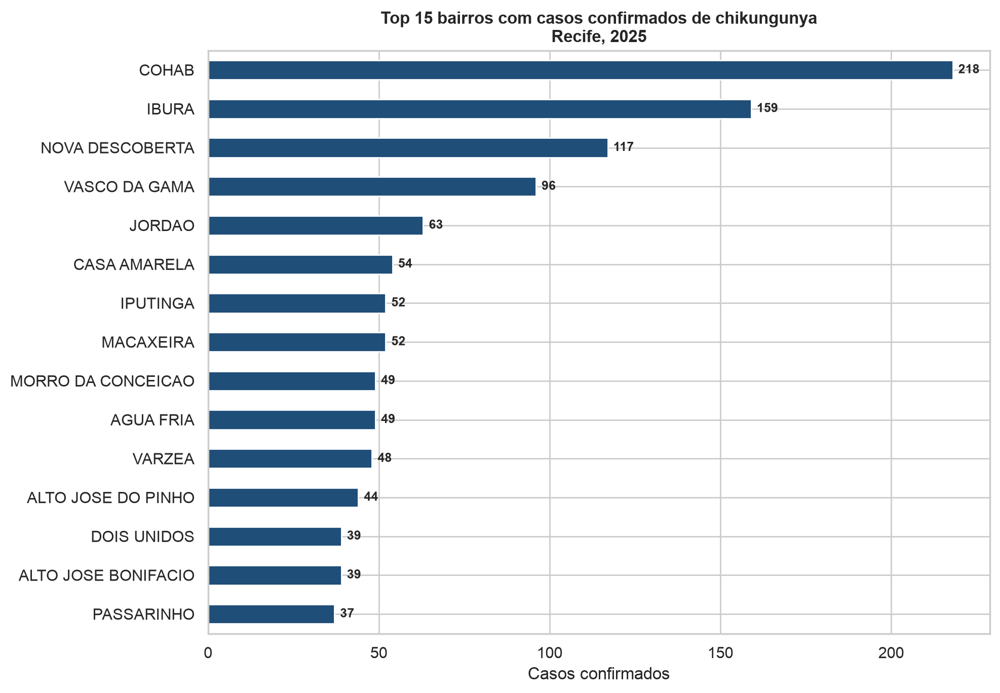
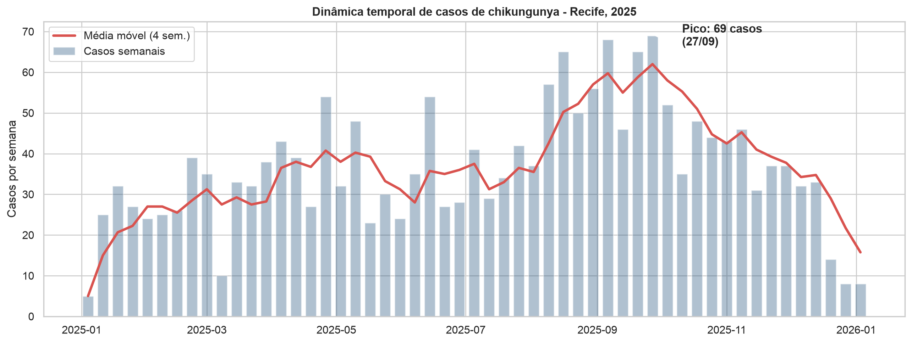
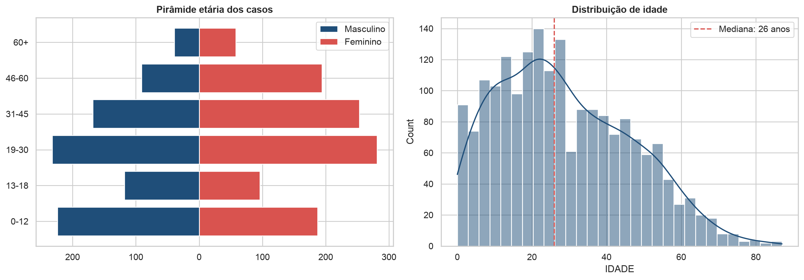

# Chikungunya em Recife (2025): análise epidemiológica, estatística e machine learning

Pipeline reprodutível em Python que analisa **1.942 casos confirmados de chikungunya** em Recife em 2025: limpeza e controle de qualidade, análise exploratória, testes de hipótese, modelagem preditiva de hospitalização, previsão de casos semanais e agrupamento de bairros por perfil epidemiológico.

> Os dados são de notificação (SINAN), disponibilizados como dados abertos pela Prefeitura do Recife. A base bruta **não** está no repositório, e nenhuma informação individual é publicada.

## Perguntas

1. Onde e quando os casos se concentram?
2. Quem são os pacientes (idade, sexo)?
3. Quais fatores se associam à hospitalização? É possível prever quem será hospitalizado a partir da ficha de notificação?
4. É possível prever o número de casos nas próximas semanas?
5. Os bairros formam grupos com perfis epidemiológicos distintos?

## Principais resultados

| Tema | Resultado |
|---|---|
| Volume | 1.942 casos confirmados |
| Concentração | 5 bairros reúnem 33,6% dos casos: Cohab (218), Ibura (159), Nova Descoberta (117), Vasco da Gama (96) e Jordão (63) |
| Pico | Semana encerrada em 27/09/2025, com 69 casos |
| Perfil | Idade mediana de 26 anos; 55% dos casos são mulheres |
| Hospitalização | 29,8% (IC 95% bootstrap: 26,5% a 33,1%) |

### Estatística inferencial

| Hipótese | Teste | p-valor | Tamanho do efeito |
|---|---|---|---|
| Sexo × hospitalização | Qui-quadrado | 0,17 | V de Cramér = 0,056 (não significativo) |
| Idade × hospitalização | Mann-Whitney | 0,0025 | r = 0,146; mediana de 20 anos (hospitalizados) vs 27 (não hospitalizados) |
| Faixa etária × hospitalização | Qui-quadrado | < 0,001 | V = 0,199 |
| Idade entre os 8 bairros mais afetados | Kruskal-Wallis | < 0,001 | ε² = 0,030 (efeito pequeno) |
| Idade, mulheres × homens | Mann-Whitney | < 0,001 | mediana de 29 vs 23 anos |

Com 1.942 observações, vários testes são significativos com efeito pequeno. Por isso o tamanho do efeito é reportado junto do p-valor.

### Machine learning: prever hospitalização

Variáveis usadas: idade, sexo, raça/cor, gestação, bairro, semana epidemiológica e dias entre início dos sintomas e notificação. Variáveis de desfecho (evolução, classificação final) foram **excluídas** para evitar vazamento de dados.

| Modelo (validação cruzada estratificada, 5 folds) | ROC-AUC | PR-AUC |
|---|---|---|
| Baseline (prevalência) | 0,500 | 0,298 |
| Regressão logística | 0,677 | 0,458 |
| Random Forest | 0,742 | 0,533 |
| Gradient Boosting | 0,715 | 0,527 |

Na avaliação **cronológica** (treino nos primeiros 70% dos casos, teste nos 30% mais recentes), o Random Forest teve ROC-AUC de 0,59 e PR-AUC de 0,50, com prevalência de 42,5% no teste.

**Leitura honesta:** os modelos superam o baseline, então há algum sinal. Ele é modesto e **perde força quando se testa no futuro**, o que indica mudança no perfil dos casos ao longo do ano. A ficha de notificação sozinha não basta para prever hospitalização de forma confiável. Métricas que dependem de limiar (recall, F1) não são reportadas aqui, porque o limiar ainda será recalibrado sem usar o conjunto de teste.

### Previsão de casos semanais

| Modelo | MAE | RMSE |
|---|---|---|
| Gradient Boosting (lags + média móvel) | 26,9 | 28,9 |
| Baseline ingênuo (semana anterior) | 7,5 | 9,9 |
| Média móvel de 4 semanas | 9,3 | 12,2 |

**O modelo de aprendizado de máquina perdeu para o baseline ingênuo.** Com cerca de 40 semanas de dados, modelos de árvore têm dificuldade em extrapolar a subida e a descida de uma epidemia. Por isso a previsão futura gerada pelo pipeline **não deve ser usada para decisão**. Está nos próximos passos testar modelos de séries temporais clássicos (ETS/SARIMA) e modelar a variação semanal.

### Clusters de bairros

K-Means sobre bairros com pelo menos 20 casos (k escolhido por silhouette) separa um grupo de alta carga (média de 188 casos, 15% de hospitalização) de grupos menores. A taxa de hospitalização varia de 14% a 55% entre clusters, o que pode refletir **diferenças de notificação entre unidades de saúde** e não só diferenças epidemiológicas. É uma hipótese, não uma conclusão.

## Visualizações

| | |
|---|---|
|  |  |
|  |  |
|  |  |

Relatório completo gerado automaticamente: [`resultados/RELATORIO.md`](resultados/RELATORIO.md).

## Metodologia

1. **Limpeza**: remoção de duplicatas, padronização de bairros (sem acentos), conversão de datas, decodificação da idade do SINAN, faixas etárias e relatório de nulos.
2. **EDA**: contagens por bairro, série semanal com média móvel, pirâmide etária e heatmap bairro × mês.
3. **Inferência**: qui-quadrado, Mann-Whitney, Kruskal-Wallis, bootstrap, sempre com tamanho de efeito.
4. **Classificação**: pipeline com imputação, padronização e one-hot; modelos comparados contra baseline; validação cruzada estratificada, holdout cronológico e importância por permutação.
5. **Série temporal**: features de lag, split cronológico e comparação com baselines.
6. **Clusterização**: K-Means com silhouette e visualização em PCA.

## Limitações

- Dados de notificação: há subnotificação e atraso de registro.
- Casos **confirmados** não são a incidência real. Sem a população por bairro, a comparação entre bairros é limitada (um bairro populoso lidera a contagem mesmo com risco menor).
- A taxa de hospitalização de ~30% é alta, o que pode indicar viés de confirmação em casos mais graves.
- Amostra pequena para validação temporal (207 casos no teste).
- Associação estatística não implica causalidade.

## Próximos passos

- Incluir a população por bairro (Censo IBGE) e calcular a **incidência por 100 mil habitantes**.
- Mapa coroplético e autocorrelação espacial (Moran's I) com a malha de bairros.
- Escolher o limiar de decisão por validação, fora do conjunto de teste, e reportar recall e F1 de forma confiável.
- Modelos de série temporal clássicos (ETS/SARIMA) e previsão da variação semanal.
- Dashboard interativo (Streamlit).

## Como executar

```bash
git clone https://github.com/joaovictorgds0/chikungunya-recife-2025.git
cd chikungunya-recife-2025
python3 -m venv .venv
source .venv/bin/activate          # Windows: .venv\Scripts\activate
pip install -r requirements.txt

# Baixe o CSV de casos confirmados de chikungunya 2025 no portal de dados abertos do Recife
# e salve em data/raw/
python chikungunya_pipeline.py --input "data/raw/NOME_DO_ARQUIVO.csv" --outdir resultados
```

Argumentos opcionais: `--pop` (CSV `bairro,populacao`) para incidência por 100 mil habitantes e `--geojson` (malha de bairros) para mapas.

## Estrutura

```
├── chikungunya_pipeline.py   # pipeline completo
├── requirements.txt
├── resultados/
│   ├── figuras/              # gráficos
│   ├── tabelas/              # tabelas agregadas
│   └── RELATORIO.md
└── data/raw/                 # base original (não versionada)
```

## Ética e privacidade

São dados de saúde. A base bruta e a base tratada não são versionadas, e apenas resultados agregados são publicados.

## Autor

**João Victor Gomes**: [LinkedIn](www.linkedin.com/in/joão-victor-gomes-da-silva-17aa68232) · [GitHub](https://github.com/joaovictorgds0)